  

<i>Convierto datos en decisiones y código en soluciones.</i>

 

<h3>Proyectos destacados</h3>

<table>
<tr>
<td width="33%" valign="top">
INGENIERÍA DE DATOS 
<b><a href="https://github.com/AndresF-GaleanoT/secop-lakehouse-aws">secop-lakehouse-aws</a></b> 
Lakehouse en AWS para la contratación pública de Colombia (SECOP II), con arquitectura Medallion y datamart en estrella. 
<code>Glue</code> <code>Step Functions</code> <code>Iceberg</code> <code>Terraform</code>
</td>
<td width="33%" valign="top">
VISIÓN POR COMPUTADOR 
<b><a href="https://github.com/AndresF-GaleanoT/gondola-inteligente">gondola-inteligente</a></b> 
Detección y tracking de personas en retail, análisis de interacción con góndolas y recomendaciones de space management. 
<code>Python</code> <code>YOLO</code> <code>ByteTrack</code>
</td>
<td width="33%" valign="top">
IA GENERATIVA 
<b><a href="https://github.com/AndresF-GaleanoT/pricepulse-ai">pricepulse-ai</a></b> 
Análisis automatizado de precios en e-commerce con agentes de IA generativa. 
<code>CrewAI</code> <code>NVIDIA NIM</code> <code>n8n</code> <code>Docker</code>
</td>
</tr>
<tr>
<td width="33%" valign="top">
CIBERSEGURIDAD 
<b><a href="https://github.com/AndresF-GaleanoT/osint-automation-platform">osint-automation-platform</a></b> 
Recolección, limpieza, análisis y enriquecimiento de datos públicos con flujos automatizados. 
<code>Python</code> <code>OSINT</code>
</td>
<td width="33%" valign="top">
BACKEND Y DEVOPS 
<b><a href="https://github.com/AndresF-GaleanoT/flask-k8s">flask-k8s</a></b> 
API REST en Flask desplegada en Kubernetes con PostgreSQL. 
<code>Flask</code> <code>Docker</code> <code>Helm</code> <code>Kubernetes</code>
</td>
<td width="33%" valign="top">
COMUNIDAD 
<b><a href="https://github.com/AndresF-GaleanoT/roadmap-ingeniero-ia-spanish">roadmap-ingeniero-ia-spanish</a></b> 
Roadmap con cursos gratuitos en español para ser Ingeniero de IA: 17 temas, 8 roles y más de 100 recursos. 
<code>IA</code> <code>Educación</code>
</td>
</tr>
</table>

<h3>Mi GitHub, como dataset</h3>

Se regenera cada día con <a href="scripts/generar.py"><code>scripts/generar.py</code></a> y GitHub Actions.

